# Visual Computing - Assignment 2

Deadline: 23.59 09.11.2026

Group: `TMP`

Group-members: 
- Tim Janush (csbb9638)
- Paul Kretz (csbb8565)
- Matti Fischbach (csbb8241)

## Setup

Change dir into src, create a `build`-dir and `cd` into it:

```bash
cd src && mkdir build && cd build
```

Run cmake in `build` with the underlying `CMakeLists.txt` (and if needed
`compile_commands.json`). 

```bash
cmake .. -DCMAKE_EXPORT_COMPILE_COMMANDS=1
```

Optional: If compile commands generated symlink them into the src dir for your lsp to pick it up

```bash
cd .. && ln -s build/compile_commands.json
```

To now compile the program run
```bash
cd build && make
```
in the build dir.

And to run the program use:
```bash
./ass02 rectify <image>                     # click corners TL, TR, BR, BL, Enter
./ass02 rectify <image> x_tl y_tl x_tr y_tr x_br y_br x_bl y_bl
./ass02 pyramid <image> [max_side]          # optional: downscale longest side first
./ass02 gabor <image> [max_side]            # Ex 3.1: filter bank + Sobel comparison
./ass02 gabor-sweep <image> [max_side]      # Ex 3.2: one parameter changed at a time
./ass02 canny <image> [max_side]            # Ex 4.1 and 4.2
./ass02 features-bench <image> [max_side]   # Ex 5A/B: benchmark -> out/features/bench.csv
./ass02 features-homography <img1> <img2> [max_side]   # Ex 5C: RANSAC homography
```
Results are written to `./build/out/`.

## 1. Perspective rectification

### What we did and why

We photographed `rectification.jpg` at a clear angle (Fig. 1.1). The four corners are
picked by mouse clicks in the order top-left, top-right, bottom-right,
bottom-left. The image is shown downscaled (so OpenCV does not crash and the
window does not use the full screen or more), and the clicks are
scaled back to full-resolution pixel coordinates. The program prints the
picked coordinates so a run can be repeated exactly.

The output size is the longer of each pair of opposite edges, so the
rectified object is not downsampled:

```cpp
float w = std::max(dist(tl, tr), dist(bl, br));
float h = std::max(dist(tl, bl), dist(tr, br));
Quad dst = {cv::Point2f(0, 0), cv::Point2f(w - 1, 0),
            cv::Point2f(w - 1, h - 1), cv::Point2f(0, h - 1)};
```

**Perspective.** A perspective transform has 8 degrees of freedom (fixed 1 in
the bottom right of the matrix). With 8 DOF's we the transformation matrix can
rotate, scale x, y and translate x, y. The 4 point pairs give exactly 8 linear
equations, so `getPerspectiveTransform` solves for H directly:

```cpp
cv::Mat H = cv::getPerspectiveTransform(src.data(), dst.data());
cv::warpPerspective(img, persp, H, cv::Size(cvRound(w), cvRound(h)));
```

**Affine.** An affine map has 6 degrees of freedom (bottom row fixed to {0, 0,
1}), so 3 pairs (TL, TR, BL) fix it completely. This has us missing x and y
translation. The 4th corner is then not used. We push it through the same matrix
to see where it lands. The output canvas has a margin, so the point stays
visible even if it lands outside the target rectangle:

```cpp
cv::Point2f src_tri[3] = {tl, tr, bl};
cv::Point2f dst_tri[3] = {dst[0] + off, dst[1] + off, dst[3] + off};
cv::Mat A = cv::getAffineTransform(src_tri, dst_tri);
cv::transform(in, out, A);                            // where BR really lands
float err_dist = cv::norm(out[0] - (dst[2] + off));   // vs. where it should land
```

### Results

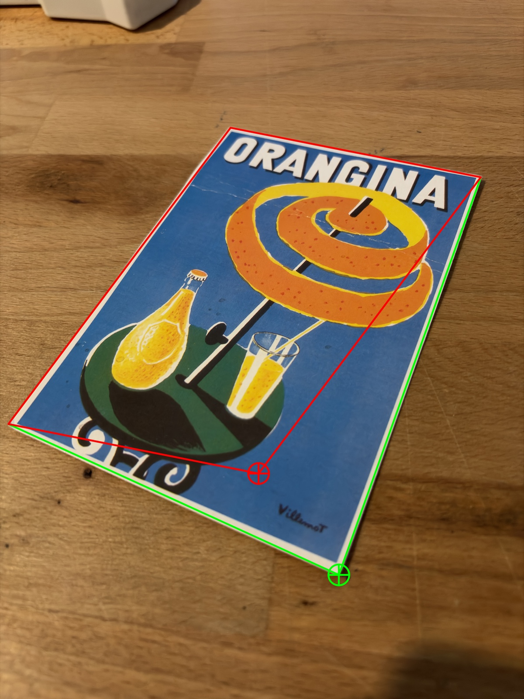
*Fig. 1.1: Input photo. Green: the 4 picked corners. Red: the parallelogram that
an affine map assumes, spanned by TL, TR and BL. The red cross is where it
expects the 4th corner; the green cross is the real one.*

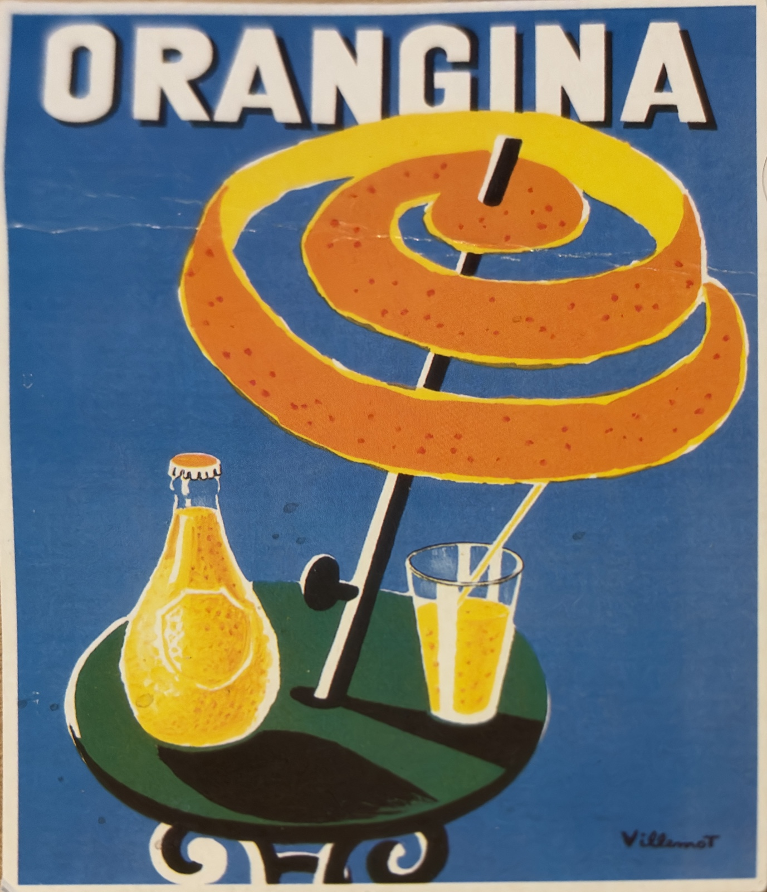
*Fig. 1.2: Rectified with `getPerspectiveTransform` + `warpPerspective`
(computed at 4195x4874 px, shown downscaled).*

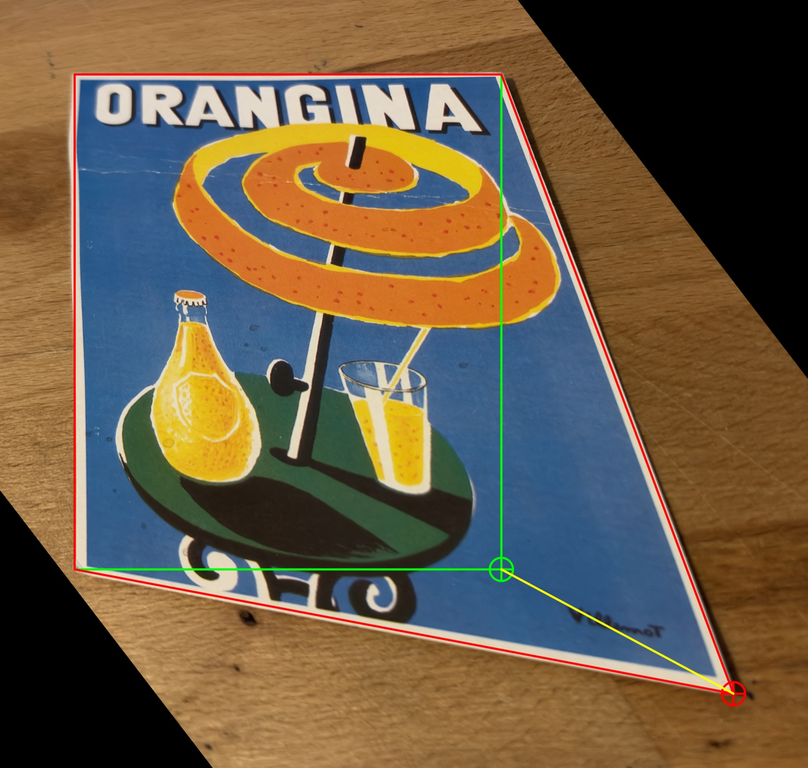
*Fig. 1.3: Warped with `getAffineTransform` from TL, TR and BL. Green: the
target rectangle. Red: the real object outline after the warp. Red cross: where
the 4th corner (BR) lands. Green cross: where it should be.*

| Quantity | Value |
|---|---|
| Distance of the 4th corner to its target, rectified image | 2588.48 px |
| Same distance in the input photo (parallelogram corner vs. real BR) | 1492.38 px |
| Angle between top and bottom edge in the photo | 13.3306 deg |
| Angle between left and right edge in the photo | 17.2288 deg |

*Table 1.1: Error of the affine approach (program output).*

### Observations

The perspective transform maps all 4 corners exactly onto the rectangle.
Straight lines stay straight, and the text and edges of the object appear
frontal. The affine warp matches TL, TR and BL exactly, because they define it.
The 4th corner misses its target by 2588.48 px, so the object becomes a tilted
quadrilateral, not a rectangle. The scale inside the object is still uneven: the
part that was further from the camera stays smaller.

**Why affine cannot do this.** An affine map `x' = A x + t` has 6 degrees of
freedom and always maps parallel lines to parallel lines. It also keeps ratios
of lengths along a line, and its scale is the same everywhere in the image. It
therefore maps parallelograms to parallelograms. Once TL, TR and BL are fixed,
BR must land at `TR + BL - TL` exactly for affine transformation to do the same
as the perspective transform. The rectangle's 4th corner is then forced,
whatever the photo shows. A camera viewing a plane at an angle performs a
projective map:

```
x' = (h11 x + h12 y + h13) / (h31 x + h32 y + 1)
```

The denominator depends on the position. It models the division by depth: points
further away get smaller. That gives 8 degrees of freedom, so we need 4 point
pairs. An affine map is the special case `h31 = h32 = 0`. To undo a perspective
image we need the inverse projective map, and no affine map can produce it.

**How the photo shows it is perspective.** In the photo, opposite edges of the
object are not parallel (Table 1.1: 13.3306 deg and 17.2288 deg). Extended, they
would meet in a vanishing point. Under an affine map they would stay parallel,
so the four corners would form a parallelogram. The real 4th corner lies 1492.38
px away from that parallelogram corner (Fig. 1.1). Also, the top and bottom
edges of the poster have the same real length, but in the photo the far top edge
measures about 0.8 % smaller than the bottom. An affine map scales parallel
segments by the same factor, so they would keep equal length.

## 2. Gaussian and Laplacian pyramid

### Note

We noticed too late that there is OpenCV functions to do the Gaussian and
Laplacian directly. This is why the implementation does most of this from
scratch.

### What we did and why

Input: the photo from Exercise 1 (`rectification.jpg`, 8064 x 6048). We first
downscaled it with `INTER_AREA` to 1024 px on the longest side
(`./ass02 pyramid rectification.jpg 1024`), giving 768 x 1024 px. At full
resolution the finest levels contain mostly sensor noise and JPEG artifacts,
and the figures would be too large for the report. All computation is done in
`CV_32FC3`. This keeps the negative values of the Laplacian levels, and
rounding cannot spoil the reconstruction.

**Gaussian pyramid (A).** We build `reduce` ourselves instead of calling
`cv::pyrDown`. The step blurs with the sampled Gauss filter [1 4 6 4 1]/16
separably in x and y (`BORDER_REFLECT_101`), then keeps every second row and
column:

```cpp
const cv::Mat kGauss = cv::Mat_<float>({1, 4, 6, 4, 1}) / 16.0f;
cv::sepFilter2D(img, blurred, -1, kGauss, kGauss, {-1, -1}, 0,
                cv::BORDER_REFLECT_101);
for (int y = 0; y < out.rows; ++y)
  for (int x = 0; x < out.cols; ++x)
    out.at<cv::Vec3f>(y, x) = blurred.at<cv::Vec3f>(2 * y, 2 * x);
```

Blurring before subsampling is needed. It removes frequencies above the new
Nyquist limit, which would otherwise alias into the smaller image. We apply it
4 times, which gives levels G0 (original) to G4.

**Laplacian pyramid (B).** `expand` is the inverse step. It writes level i+1
onto the even pixels of a zero image of the size of level i. Then it blurs
with the same kernel times 2 per axis: only every 4th pixel is non-zero, so
the brightness has to be multiplied by 4. Passing the target size handles odd
image sizes.

```cpp
L[i] = G[i] - expand(G[i + 1], G[i].size());   // i = 0..3
L[4] = G[4];                                   // top: smallest Gaussian level
// reconstruction, coarse to fine:
img = L[4];
for (int i = 3; i >= 0; --i) img = L[i] + expand(img, L[i].size());
```

Laplacian values are signed and small. For display we show `128 + 2 * L`, so
grey means 0, brighter means positive and darker means negative.

### Results

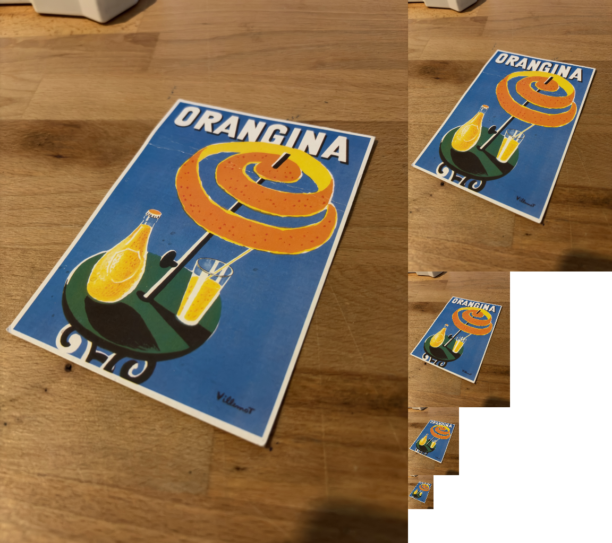
*Fig. 2.1: Gaussian pyramid. Left: G0 (768 x 1024). Right, top to bottom:
G1 (384 x 512), G2 (192 x 256), G3 (96 x 128), G4 (48 x 64).*

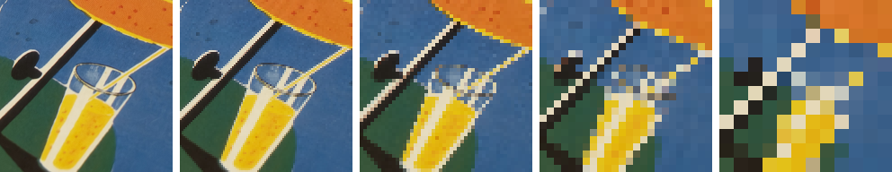
*Fig. 2.2: The same center crop from G0 ... G4, scaled up to the same size with
nearest neighbour. One block in the right image is one pixel of G4.*

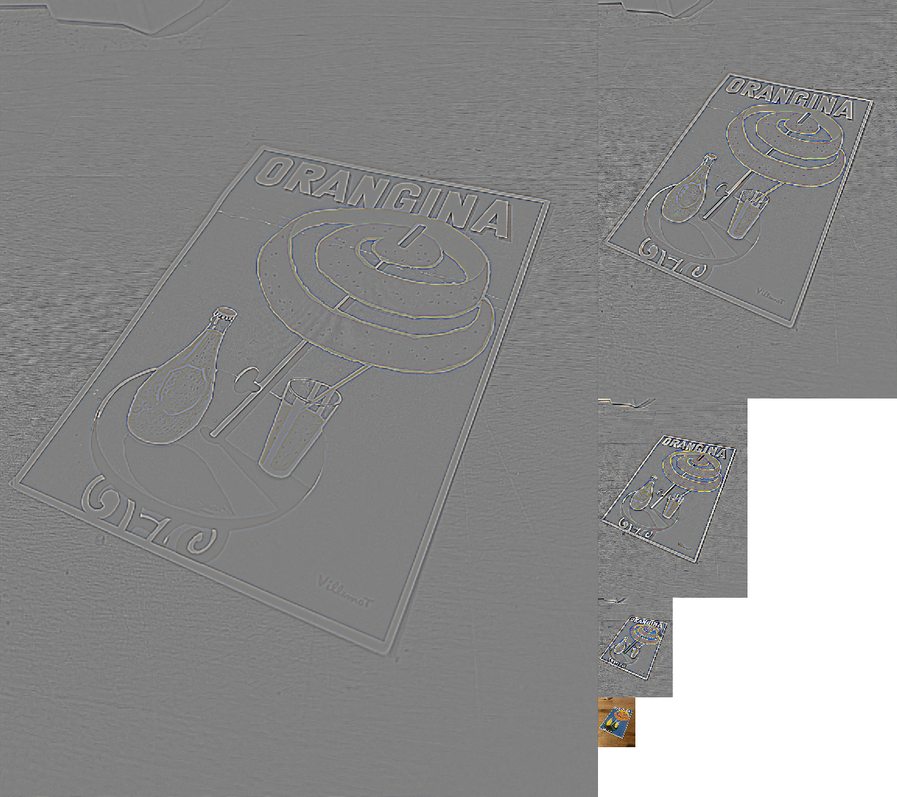
*Fig. 2.3: Laplacian pyramid L0 ... L3 (shown as 128 + 2 * L), and the
smallest Gaussian level G4 as the top level (bottom right, normal colours).*

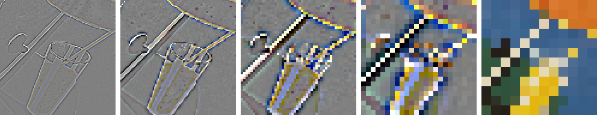
*Fig. 2.4: The same center crop from L0 ... L3 and G4, as in Fig. 2.2.*

| Level | Size | min L | max L |
|---|---|---|---|
| 0 | 768 x 1024 | -112.3 | 109.0 |
| 1 | 384 x 512 | -151.0 | 126.3 |
| 2 | 192 x 256 | -176.5 | 151.5 |
| 3 | 96 x 128 | -166.8 | 173.0 |
| 4 (= G4) | 48 x 64 | 3.0 | 233.0 |

*Table 2.1: Level sizes and value range of each Laplacian level (all channels).*

| Comparison | max \|reconstructed - original\| |
|---|---|
| float (`CV_32FC3`) | 0 |
| after conversion to 8 bit | 0 |

*Table 2.2: Reconstruction error from L0 ... L3 and G4.*

### Observations

**Low frequencies** are the parts of the image that change slowly over space.
Examples are the overall brightness and colour of regions (blue poster,
orange spiral, brown table), large smooth gradients from the lighting, and the
coarse shape of objects. They survive down to G4: at 48 x 64 px you can still
see a blue rectangle with an orange spot on a brown background.

**Details that disappear first** are the finest structures, only 1 to 2 px
wide in G0. Here these are the wood grain and scratches on the table, the thin
white outlines of the glass and the straw, the small dots on the orange
spiral, the signature ("Villemot"), and image noise. In G1 the signature is
already hard to read. In G2 the dots on the spiral are gone, and the rim of
the glass and the straw blur together (Fig. 2.2). In G3 and G4 only the
colour areas (spiral, glass, green table top) and the outline of the poster
are left. Each reduce step
halves the highest frequency the image can show, so the smallest structures
go first.

**Each Laplacian level contains** the band of frequencies that is lost between
two Gaussian levels: `L_i = G_i - expand(G_{i+1})`. It is a band-pass image
with mean about 0. Most of it is grey, and it is non-zero only at edges and
texture of the matching size.
- L0: the finest details: wood grain, thin outlines, the spiral dots and
  letter strokes, noise.
- L1: slightly coarser structure: outlines of the glass, straw and bottle,
  thicker grain.
- L2 and L3: the edges of the spiral, the black pole and the poster's border,
  as broad light/dark bands.
- The top level G4: the remaining low-pass image (average colours).

The value range grows from L0 to L3 (Table 2.1). Most of the contrast of
this image sits in large, strong edges (black pole and white border against
the blue, poster against the table), which belong to the coarser bands. The
fine texture is weak.

**Reconstruction** is exact: the largest difference is 0 already in float,
and also after conversion to 8 bit. This is expected, because by construction
`G_i = L_i + expand(G_{i+1})`. The same `expand` is used to build and to
reconstruct, so the pyramid does not lose any information.

**Uses of the pyramid:**
- **Compression:** Laplacian levels are mostly about 0 and can be quantized
  strongly. This was the original use (Burt & Adelson 1983).
- **Image blending / mosaics:** blend each level with a mask of matching
  blur, then reconstruct. This gives seamless transitions, e.g. the
  "orapple".
- **Multi-scale analysis:** finding features at different sizes, e.g. the
  scale space in SIFT, or coarse-to-fine optical flow and image
  registration.
- **Editing:** sharpening or denoising by amplifying or damping single
  frequency bands, and progressive transmission (send G4 first, then the
  L levels).

## 3. Gabor filter bank

### What we did and why

Input: the photo from Exercise 1 (`rectification.jpg`, 8064 x 6048). We first
downscaled it with `INTER_AREA` to 1000 px on the longest side
(`./ass02 gabor rectification.jpg 1000`), giving 750 x 1000 px. At full
resolution a wavelength of 10 px only matches tiny details like wood grain and
noise, and every output image would be 10 to 16 MB. The image is converted to
greyscale and to float in [0, 1], because the filter responses are signed.

**Filter bank (1).** For each orientation 0, 45, 90 and 135 deg we build one
kernel with `getGaborKernel` (theta in radians). We use `ksize = 31`,
`sigma = 4` (width of the Gaussian envelope), `lambda = 10` (wavelength of the
stripes in px), `gamma = 0.5` (aspect ratio of the envelope, < 1 means
stretched along the stripes) and `psi = 0` (phase, symmetric kernel with a
bright center stripe). `ksize` has to cover about +-3 sigma, otherwise the
kernel is cut off.

```cpp
cv::Mat k = cv::getGaborKernel(cv::Size(p.ksize, p.ksize), p.sigma,
                               deg * CV_PI / 180.0, p.lambda, p.gamma,
                               p.psi, CV_32F);
k -= cv::mean(k)[0]; // zero mean: flat areas give 0
```

Removing the mean is needed. With `psi = 0` the values of the OpenCV kernel
sum to about 8, not 0. Such a kernel also acts like a blur: on a flat area it
returns 8 times the brightness. Our first results looked like a low-contrast
copy of the photo, because the brightness dominated the stripe response. After
removing the mean (the DC part), flat areas give 0 and only structure remains.

Each kernel is applied with `filter2D` and a float output (`CV_32F`). The four
responses are combined by the per-pixel maximum. We compared two variants: the
maximum of the signed responses ("raw") and the maximum of the absolute values
("abs"):

```cpp
cv::filter2D(gray, r, CV_32F, k);              // for each orientation
cv::Mat combined = cv::abs(responses[0]);
for (size_t i = 1; i < responses.size(); i++) {
  cv::Mat a = cv::abs(responses[i]);
  cv::max(combined, a, combined);
}
```

For display every float image is stretched to 0 to 255 with `normalize`
(`NORM_MINMAX`). For kernels and signed responses, grey therefore means 0,
brighter means positive and darker means negative. The kernels are scaled up
with nearest neighbour to the height of the result and placed to its left.

**Parameter sweep (2).** `./ass02 gabor-sweep` runs the whole bank (abs
variant) again with the default values from above and changes exactly one
parameter at a time. Only in the sigma sweep we use `ksize = 61` for all three
values, otherwise the kernel for sigma = 8 would be cut off.

**Sobel (2).** For the comparison we compute the gradient magnitude on the same
greyscale image:

```cpp
cv::Sobel(gray, gx, CV_32F, 1, 0, 3);
cv::Sobel(gray, gy, CV_32F, 0, 1, 3);
cv::magnitude(gx, gy, mag);
```

### Results

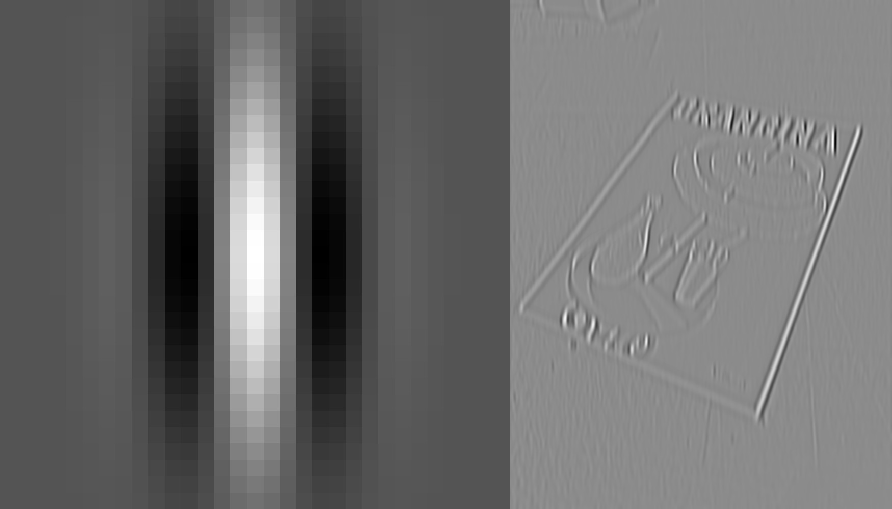
*Fig. 3.1: Left: kernel 0 deg (vertical stripes). Right: its signed response
(grey = 0).*

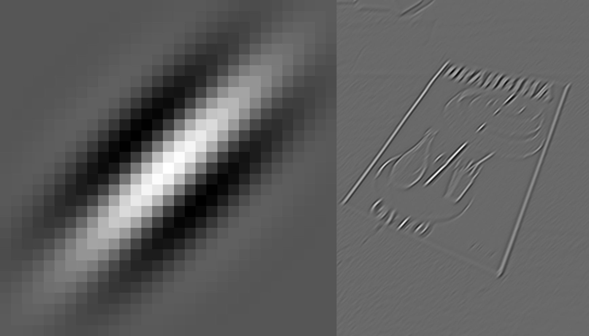
*Fig. 3.2: Left: kernel 45 deg. Right: its signed response.*

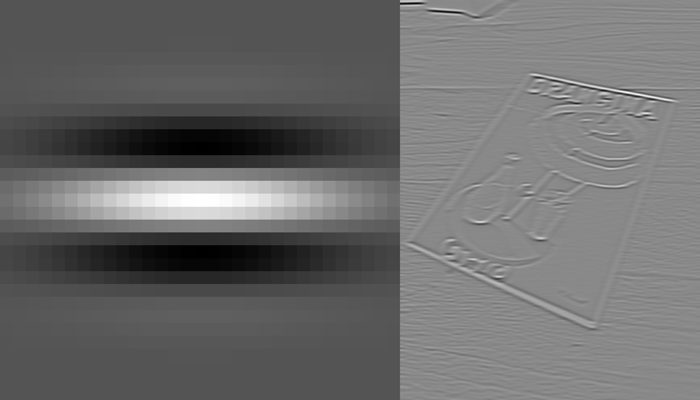
*Fig. 3.3: Left: kernel 90 deg (horizontal stripes). Right: its signed
response.*

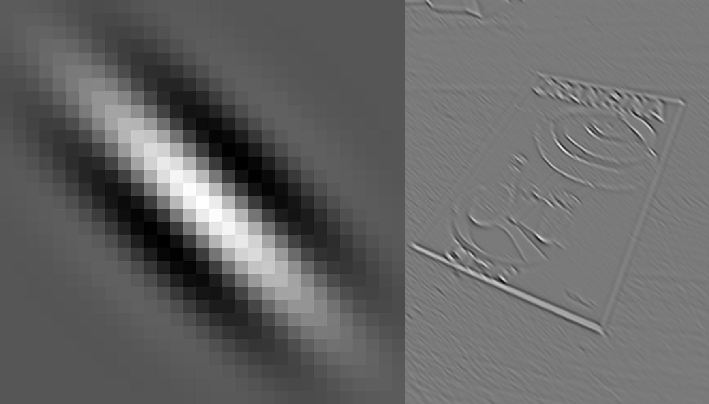
*Fig. 3.4: Left: kernel 135 deg. Right: its signed response.*

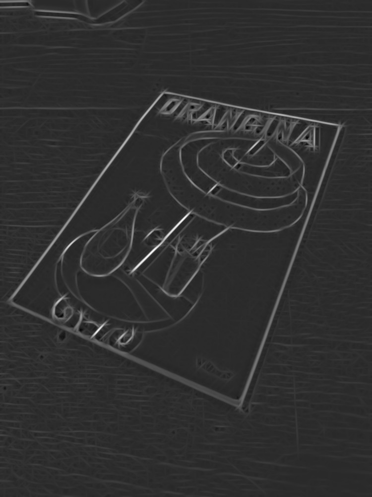
*Fig. 3.5: The four responses combined by the maximum of the signed values
("raw").*

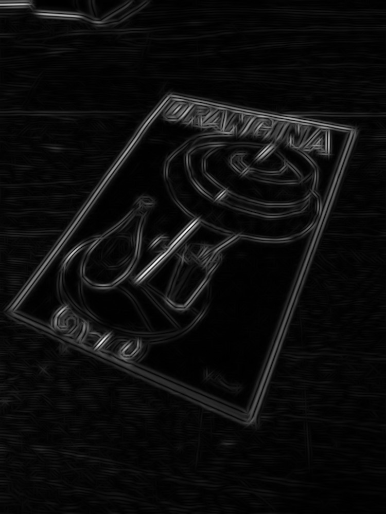
*Fig. 3.6: The four responses combined by the maximum of the absolute values
("abs"). This variant is used for the sweep and the Sobel comparison.*

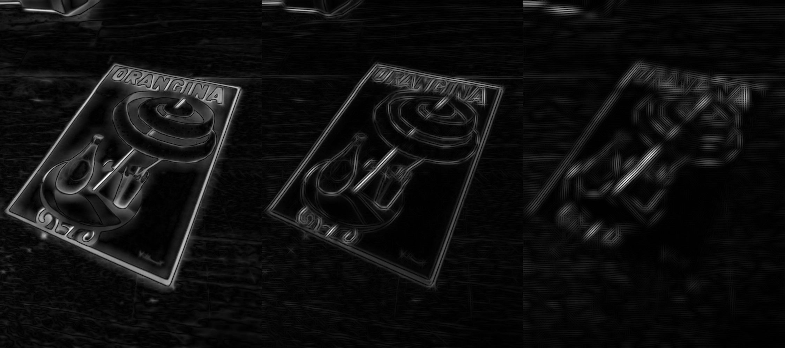
*Fig. 3.7: Combined result for sigma = 2, 4 and 8 (left to right, ksize = 61).*

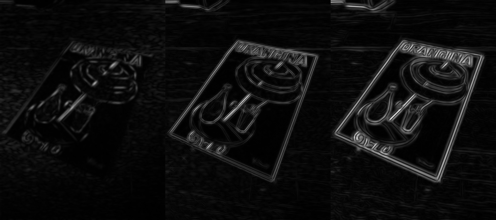
*Fig. 3.8: Combined result for lambda = 5, 10 and 20.*

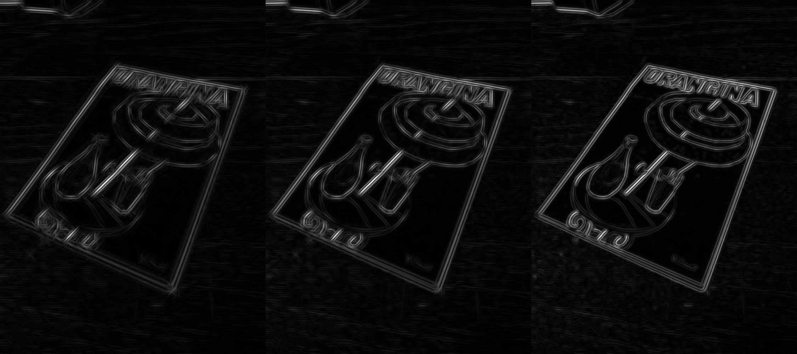
*Fig. 3.9: Combined result for gamma = 0.25, 0.5 and 1.*

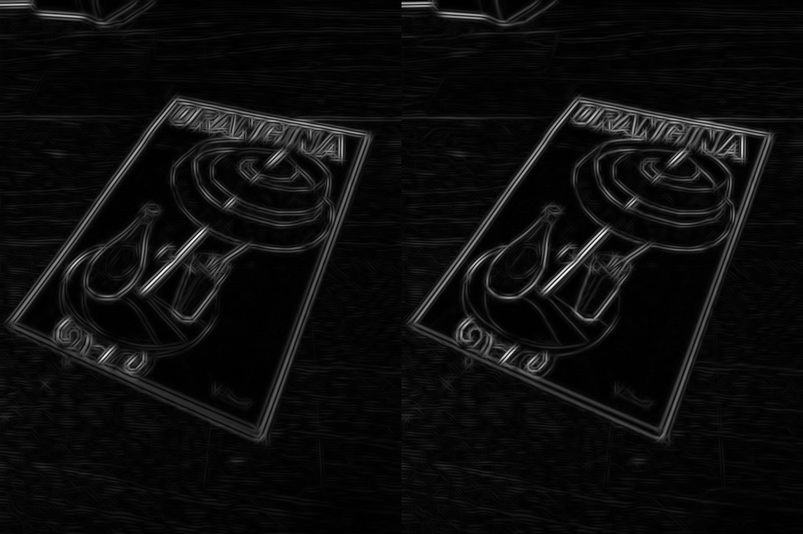
*Fig. 3.10: Combined result for psi = 0 and 90 deg.*

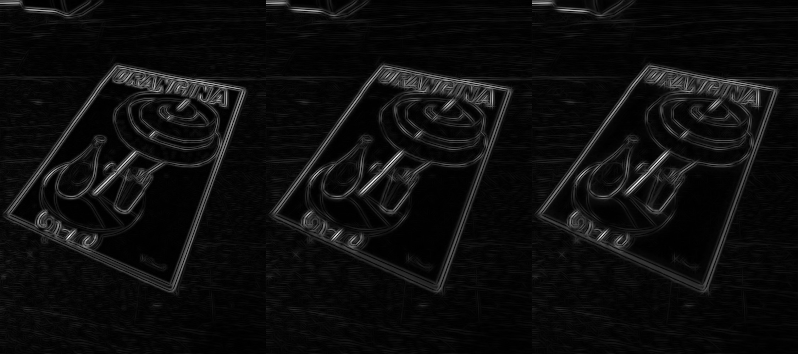
*Fig. 3.11: Combined result for ksize = 15, 31 and 61.*

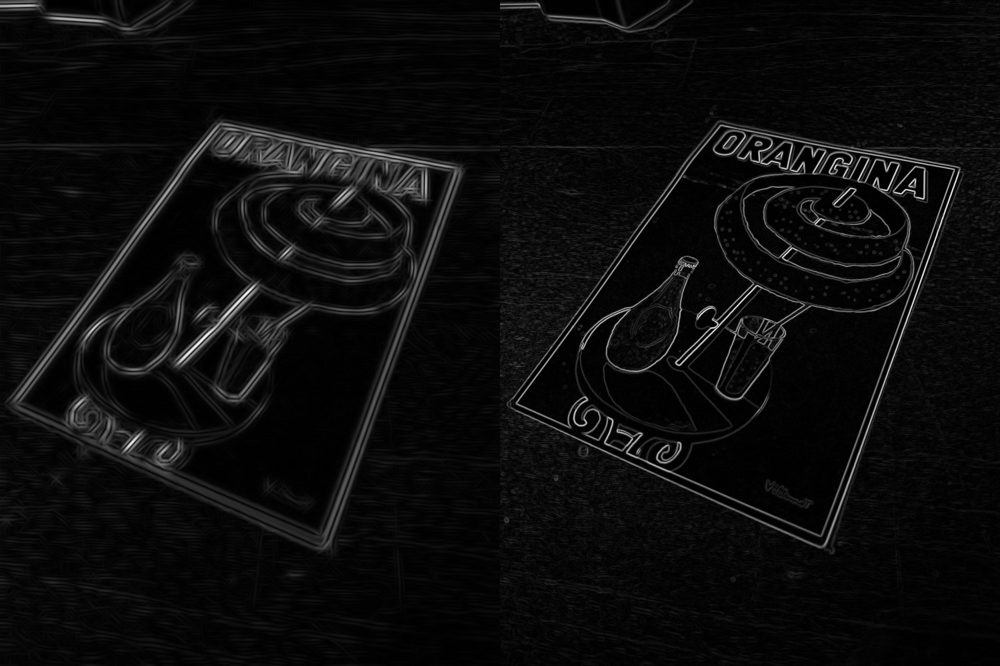
*Fig. 3.12: Left: Gabor bank (abs, default parameters). Right: Sobel gradient
magnitude.*

### Observations

**Each orientation** responds to lines and edges that run parallel to its
stripes (Fig. 3.1 ... 3.4). The 0 deg kernel marks the steep long edges of the
poster and the vertical strokes of the letters, while the horizontal wood grain
almost disappears. The 90 deg kernel is the opposite: the wood grain and the
top and bottom edges of the poster are strong. The 45 deg kernel matches the
long poster edges best, because the poster lies tilted in the photo. The
135 deg kernel shows the shorter poster edges and strokes in the other diagonal
direction. Thin bright lines give a bright response, thin dark lines a dark
one.

**Raw vs. abs.** The raw maximum only keeps positive responses, so dark lines
on a bright background lose (Fig. 3.5). At corners the four orientations
disagree, and star-shaped streaks from the side stripes of the kernels appear.
With the absolute value, bright and dark lines count the same and flat areas
are black (Fig. 3.6). Every edge now gives a double line. With `psi = 0` the
kernel is a line detector (bright center, dark sides), so a step edge gives a
positive response on one side and a negative one on the other.

**What each parameter does:**
- **sigma** sets the size of the envelope and so the number of visible
  stripes (Fig. 3.7). With sigma = 2 the envelope is smaller than one
  wavelength and only one stripe is left. The kernel works like a blob or edge
  detector with wide halos. With sigma = 8 there are many stripes and the
  kernel is very selective. Only long straight structures with period lambda
  remain, with striped ringing, and the letters fall apart.
- **lambda** sets the distance between the stripes (Fig. 3.8). lambda = 5 only
  finds very fine details and is weak and noisy. lambda = 20 gives thick lines,
  the double contours move apart, and the result is smoother.
- **gamma** sets the shape of the envelope: 0.25 is long and narrow, 1 is
  round (Fig. 3.9). A small gamma prefers long straight edges and is more
  selective in orientation, but gives streaks at corners. gamma = 1 also picks
  up short structures and more background texture.
- **psi** shifts the phase (Fig. 3.10). psi = 0 gives a symmetric kernel (line
  detector), psi = 90 deg an antisymmetric dark/bright kernel (edge detector).
  With psi = 90 deg each edge gives one contour instead of the double line.
- **ksize** only cuts the kernel (Fig. 3.11). With 15 px the outer stripes are
  cut off (15 px < 6 sigma). 31 and 61 look almost the same, because the
  envelope is already about 0 at the border.

**Best setting.** For this photo the defaults (sigma = 4, lambda = 10,
gamma = 0.5, ksize = 31) find the structures best. The poster border, the
letters, the pole and the outlines of bottle and glass are clean closed
contours, and the wood grain stays weak. For an edge map with single lines,
psi = 90 deg is the better choice.

**Gabor vs. Sobel** (Fig. 3.12):
- **Gabor finds, Sobel does not:** the bank is selective in orientation and in
  scale. It answers strongly to structures with a width of about lambda / 2,
  such as the poster border and the pole, and suppresses finer noise and
  texture. Each orientation can be read out on its own (Fig. 3.1 ... 3.4),
  while Sobel only gives one magnitude without frequency information. A thin
  line gives one response with Gabor, but two edges with Sobel.
- **Sobel finds, Gabor does not:** Sobel uses a 3 x 3 kernel, so its contours
  are thin and sharp. It finds every edge regardless of its width and
  direction. This includes the small dots on the rings and the fine signature,
  which are smaller than the Gabor wavelength. In turn, Sobel also responds to
  more fine wood texture and noise.

## 4. Canny with automatic thresholds

### What we did and why

Inputs: the poster photo from Exercise 1 (`rectification.jpg`) and a second
photo with a very different look (`image_2.jpg`, 3024 x 4032): a bowl full of
coins, screws and sticky notes on a bright white table. Both are downscaled to
1000 px on the longest side (`./ass02 canny <image> 1000`), giving 750 x 1000
px. Hand-tuned thresholds depend on the resolution, so both images are used at
the same size.

Canny works in five steps (PS, slide 38): (1) smooth with a Gaussian, (2)
gradient magnitude and direction with Sobel, (3) non-maximum suppression, which
thins every edge to 1 px, (4) double threshold into strong (G >= high) and weak
(low <= G < high) pixels, (5) hysteresis, which keeps a weak pixel only if it
is connected to a strong one. Step 1 we do ourselves, because `cv::Canny` does
not smooth. We use a 5 x 5 Gaussian with sigma = 1.4 as on slide 39. Steps 2 to
5 run inside `cv::Canny`, and the only thing we have to choose are the two
thresholds of step 4.

**Otsu (1).** Otsu's method picks the grey value that splits the histogram into
two classes with the smallest variance inside each class. `cv::threshold`
returns this value. We use it as the high threshold and half of it as the low
one (slide 43: high : low = 2:1 to 3:1):

```cpp
cv::GaussianBlur(src_gray, blurred, cv::Size(5, 5), 1.4);
double otsu = cv::threshold(blurred, otsu_bin, 0, 255,
                            cv::THRESH_BINARY | cv::THRESH_OTSU);
cv::Canny(blurred, edges_otsu, otsu / 2, otsu, 3);
```

**Comparison (2).** All detectors get the same blurred image, so only the
detector differs. Sobel and Laplacian are built as in the PS code: signed
`CV_16S` output (with `CV_8U` the negative derivatives would be cut off),
`convertScaleAbs` to get back to 8 bit, and for Sobel the sum
0.5 |Gx| + 0.5 |Gy|. The Laplacian response is weak, so we scale it by 4 in
`convertScaleAbs` to make it visible. For the hand-tuned Canny we started at
50 / 150 (slide 45) and lowered the values until the fine details of the poster
(signature, inner lines of the bottle) appeared, which gave 30 / 90 (3:1).
To compare the two Canny results with a number, we count their edge pixels
with `cv::countNonZero`, since the Canny output is binary (edge = 255,
rest = 0).

```cpp
cv::Sobel(blurred, grad_x, CV_16S, 1, 0, 3);
cv::Sobel(blurred, grad_y, CV_16S, 0, 1, 3);
cv::convertScaleAbs(grad_x, abs_grad_x);
cv::convertScaleAbs(grad_y, abs_grad_y);
cv::addWeighted(abs_grad_x, 0.5, abs_grad_y, 0.5, 0, sobel);

cv::Laplacian(blurred, lap, CV_16S, 3);
cv::convertScaleAbs(lap, abs_lap, 4);
```

### Results

| Image         | Otsu value | Canny Otsu low / high | edge px (Otsu) | Canny hand low / high | edge px (hand) |
|---------------|-----------:|----------------------:|---------------:|----------------------:|---------------:|
| rectification | 110        | 55 / 110              | 17735 (2.4 %)  | 30 / 90               | 19655 (2.6 %)  |
| image_2       | 129        | 64.5 / 129            | 17509 (2.3 %)  | 30 / 90               | 23756 (3.2 %)  |

*Table 4.1: Thresholds and number of edge pixels (out of 750 000) for both
images.*

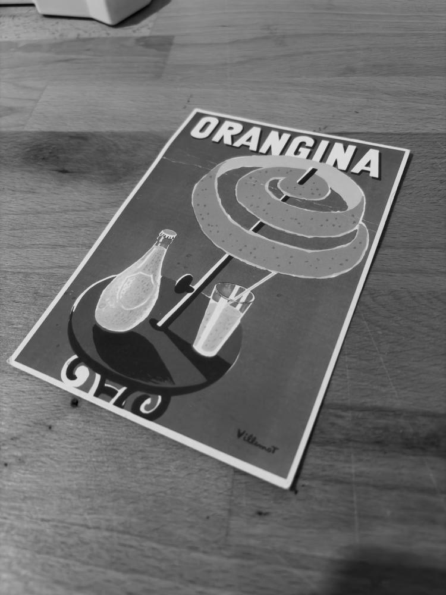
*Fig. 4.1: Greyscale input 1, poster on a wooden table.*

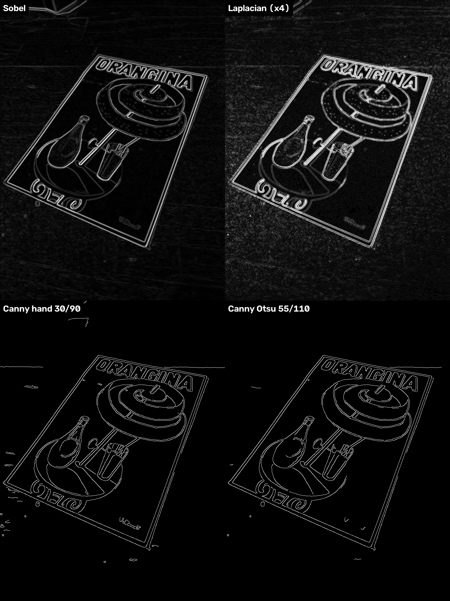
*Fig. 4.2: Input 1. Top: Sobel, Laplacian (scaled x4). Bottom: Canny with
hand-tuned thresholds (30 / 90), Canny with Otsu thresholds (55 / 110).*

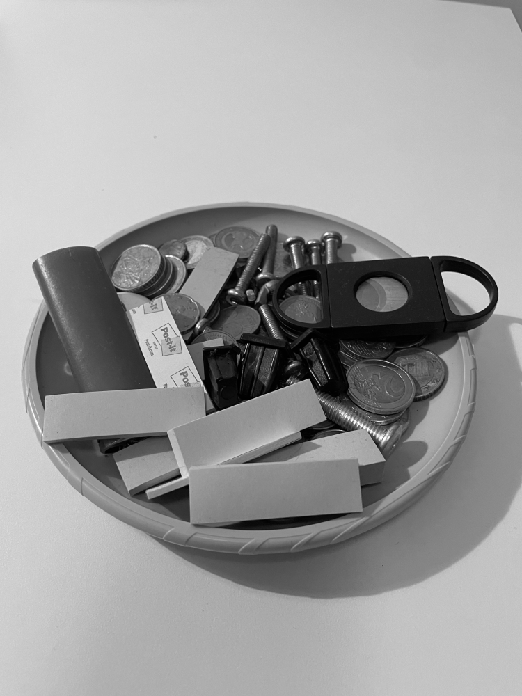
*Fig. 4.3: Greyscale input 2, bowl with small objects on a white table.*

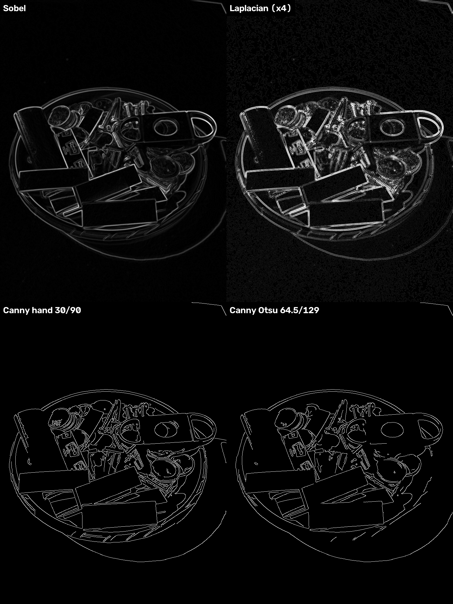
*Fig. 4.4: Input 2. Top: Sobel, Laplacian (scaled x4). Bottom: Canny
hand-tuned (30 / 90), Canny with Otsu thresholds (64.5 / 129).*

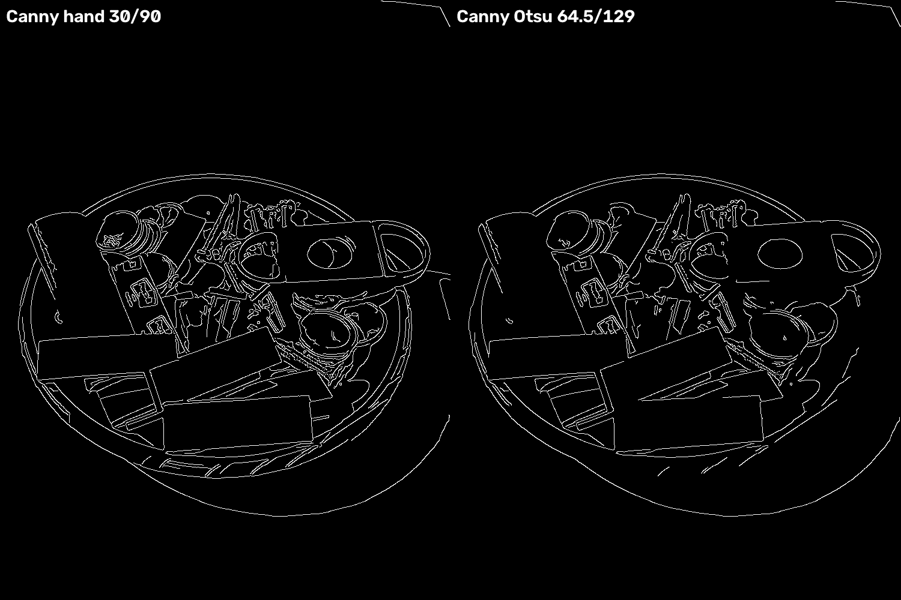
*Fig. 4.5: Input 2, Canny hand-tuned (left) and with Otsu thresholds (right).*

### Observations

**Sobel** (Fig. 4.2, 4.4) finds all important contours, but they are several
pixels wide and blurry, because there is no non-maximum suppression. The result
is a grey magnitude, not an edge map, so a threshold would still be needed. The
wood grain of the table shows up as texture over the whole image.

**Laplacian** is the second derivative, so an edge lies at a zero crossing and
the absolute value gives a double line on both sides of it. Its raw response
is weak, so we had to scale it by 4. After that the contours are bright and
sharp, but the scaling also amplifies the noise: the Laplacian reacts most to
noise of all methods, and the wood and the white table are covered in fine
speckle.

**Canny** gives thin (1 px) and mostly closed contours on both images. Between
the two threshold choices there is the trade-off from slide 45:
- **Hand-tuned 30 / 90** is lower, so it is more complete. On the poster it
  finds the signature "Villemot" and more lines inside the bottle, on image 2
  more coin and screw outlines and the pattern on the rim of the bowl. In
  return it also keeps more false edges: pieces of wood grain and shadow next
  to the poster, and many short fragments in the pile of coins (about 36 % more
  edge pixels than Otsu on image 2, Table 4.1).
- **Otsu** is cleaner. The table texture is almost gone and only the strong
  object contours remain, but the signature and some inner details are lost.
  Otsu also adapts on its own: on the bright image 2 it picks a higher value
  (129) than on the darker poster (110), while the hand-tuned values stay the
  same for both images.

Otsu is only a heuristic for Canny. It separates grey values (bright vs. dark
regions), but Canny's thresholds act on the gradient magnitude, which is a
different quantity. It works here because both photos have a clear
bright / dark split. An example of the limit is the shadow of the bowl in image
2: it is a strong brightness step and is found as an edge by every method,
although it is not an object edge.

**Ranking (worst to best).** Criteria, taken from the goal of Canny on slide
38 ("thin, connected edges with few false edges") plus completeness and tuning
effort:
1. **Laplacian:** most noise-sensitive, double edges, weak raw response.
2. **Sobel:** robust and complete, but thick edges and no decision what an edge
   is.
3. **Canny hand-tuned:** thin and connected, most details, but more false edges
   and the values have to be found by hand for every image.
4. **Canny Otsu:** thin, connected, fewest false edges and fully automatic.

The ranking is the same for both images. Hand-tuned and Otsu are close: if
completeness matters most, the hand-tuned version wins on the poster. Otsu is
first for us because it gives a clean result on both images without any
tuning.

## 5. Feature detectors: benchmark and homography

### What we did and why

**Benchmark (A).** Input is the poster photo from Exercise 1
(`rectification.jpg`), downscaled to 1000 px on the longest side
(`./ass02 features-bench rectification.jpg 1000`), giving 750 x 1000 px. We
build the transformed copy ourselves with `warpPerspective`, so we know the
true homography H for every pixel. This is the ground truth that lets us
check every single match, not only count them.

H is built as a 3 x 3 matrix for each transformation. Rotation and scaling
come from `getRotationMatrix2D` around the image center. This returns the 2 x
3 affine matrix, so we append the row {0, 0, 1} to get a homography. For the
perspective tilt we move the two top corners inwards by 20 % of the width and
solve for H with `getPerspectiveTransform`, so the image looks like it leans
back:

```cpp
cv::Mat M = cv::getRotationMatrix2D(center, angle, scale);   // 2x3
cv::vconcat(M, cv::Mat(cv::Matx13d(0, 0, 1)), H);            // 3x3

const float d = 0.2f * w;
std::vector<cv::Point2f> src = {{0, 0}, {w, 0}, {w, h}, {0, h}};
std::vector<cv::Point2f> dst = {{d, 0}, {w - d, 0}, {w, h}, {0, h}};
cv::Mat H = cv::getPerspectiveTransform(src, dst);
```

All three detectors produce binary descriptors, so we match them with a
brute-force matcher and the Hamming distance (number of different bits). A
nearest neighbour always exists, even for a keypoint that has no partner in
the other image. We therefore use Lowe's ratio test: `knnMatch` returns the
best and second best candidate, and we keep a match only if the best one is
clearly better (distance < 0.8 x second distance). These are the "kept"
matches. On repeated texture (letters, wood grain) both candidates are almost
equally close and the match is dropped as ambiguous.

```cpp
cv::BFMatcher matcher(cv::NORM_HAMMING);
matcher.knnMatch(desc1, desc2, knn, 2);
for (const auto &pair : knn)
  if (pair.size() == 2 && pair[0].distance < ratio * pair[1].distance)
    kept.push_back(pair[0]);
```

A kept match is **correct** if the keypoint from image 1, mapped with the true
H, lands within 3 px of its matched keypoint in image 2:

```cpp
cv::perspectiveTransform(kp1Matches, projected, H);
for (size_t i = 0; i < matches.size(); ++i)
  if (cv::norm(projected[i] - kp2[matches[i].trainIdx].pt) < max_px)
    correct++;
```

Precision is correct / kept. Runtime is measured with `std::chrono` around
`detectAndCompute` for both images plus the matching. The first call of every
detector is much slower (memory allocation, thread pool start-up; ORB took 72
ms instead of 18 ms), so every detector is run once on the input before the
timed loop. Detector parameters: ORB with `nfeatures = 2000` (default is 500),
AKAZE and BRISK with OpenCV defaults. In OpenCV 5, ORB is in
`opencv2/features.hpp`, AKAZE and BRISK in `opencv2/xfeatures2d.hpp`
(`cv::xfeatures2d::AKAZE`) and `findHomography` in `opencv2/geometry/3d.hpp`.

**Experiments (B).** Rotation by 0, 30, 60 and 90 deg (scale 1), scaling by
0.25, 0.5, 2 and 3 (no rotation), and one tilt of 0.2. The output image keeps
the input size, so at 90 deg and at scale 2 and 3 parts of the content leave
the frame. Fewer correct matches there are partly caused by the smaller
overlap, not only by the detector. Precision is not affected by this, so we
look at both. The plots are made from the CSV with `plot_bench.py`
(matplotlib).

**Homography from real photos (C).** We photographed a magazine on a table
from two positions (`a.jpg`, `b.jpg`, 3024 x 4032, downscaled to 900 x 1200
with `./ass02 features-homography a.jpg b.jpg 1200`). The camera is rotated by
about 30 deg and looks from a different angle, but stays at a similar
distance. A cup next to the magazine is a 3D object outside the plane. We use
ORB (`nfeatures = 5000`): it is the fastest detector and has the highest
precision for moderate transformations (rotation 30 deg and tilt: 0.94,
Table 5.1). Its weak point, large scale changes, is avoided by keeping the
distance similar. The matches go into `findHomography` with RANSAC and a 3 px
threshold. The returned mask marks the inliers:

```cpp
cv::Mat H = cv::findHomography(pts1, pts2, cv::RANSAC, 3.0, mask);
int inliers = cv::countNonZero(mask);
cv::warpPerspective(img1, warped, H, img2.size());
cv::addWeighted(warped, 0.5, img2, 0.5, 0.0, overlay);
```

To check H we also map the border of photo 1 with `perspectiveTransform` and
draw it into photo 2.

### Results

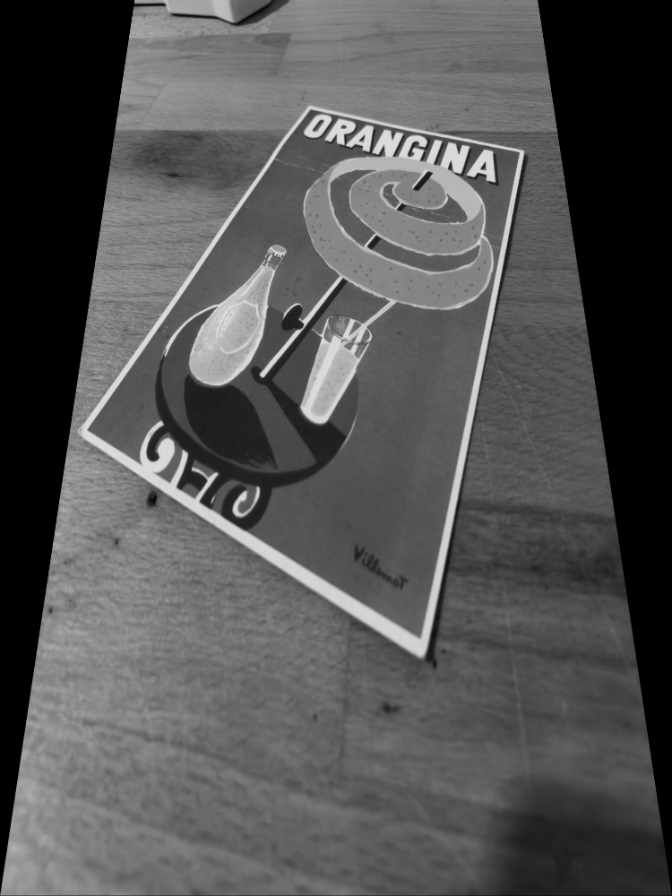
*Fig. 5.1: Example of a transformed copy: perspective tilt 0.2 (top corners
moved inwards by 20 % of the width).*

| Transformation | ORB correct / kept (prec.) | AKAZE correct / kept (prec.) | BRISK correct / kept (prec.) |
|---|---:|---:|---:|
| rotation 0 deg  | 2000 / 2000 (1.00) | 1080 / 1080 (1.00) | 1164 / 1164 (1.00) |
| rotation 30 deg | 1346 / 1437 (0.94) | 787 / 863 (0.91)   | 519 / 612 (0.85)   |
| rotation 60 deg | 1344 / 1474 (0.91) | 744 / 801 (0.93)   | 549 / 651 (0.84)   |
| rotation 90 deg | 1434 / 1617 (0.89) | 897 / 926 (0.97)   | 720 / 820 (0.88)   |
| scale 0.25      | 67 / 94 (0.71)     | 82 / 119 (0.69)    | 143 / 161 (0.89)   |
| scale 0.5       | 577 / 603 (0.96)   | 357 / 405 (0.88)   | 422 / 455 (0.93)   |
| scale 2         | 358 / 469 (0.76)   | 210 / 244 (0.86)   | 221 / 282 (0.78)   |
| scale 3         | 121 / 226 (0.54)   | 74 / 120 (0.62)    | 105 / 175 (0.60)   |
| tilt 0.2        | 861 / 918 (0.94)   | 435 / 498 (0.87)   | 409 / 483 (0.85)   |

*Table 5.1: Kept matches (after ratio test), correct matches (< 3 px from the
true position) and precision for every detector and transformation. Keypoints
in image 1: ORB 2000 (capped), AKAZE 1080, BRISK 1164.*

| Detector | Runtime per pair (ms) |
|---|---:|
| ORB   | 17 - 20  |
| BRISK | 22 - 31  |
| AKAZE | 99 - 108 |

*Table 5.2: Runtime for detection + description of both images and matching,
range over all 9 transformations (after warm-up).*

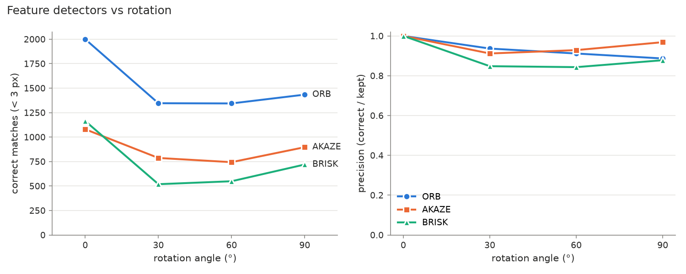
*Fig. 5.2: Correct matches (left) and precision (right) against the rotation
angle, scale 1.*

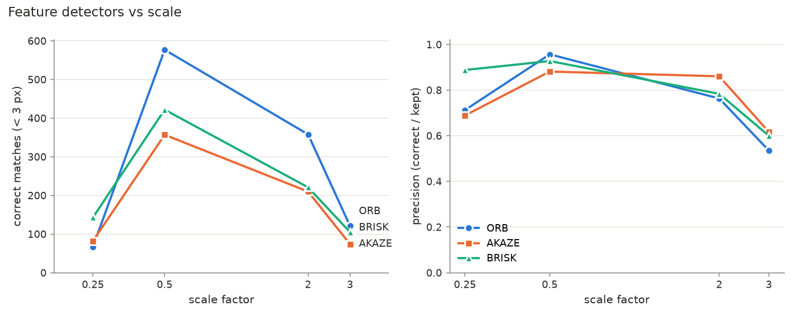
*Fig. 5.3: Correct matches (left) and precision (right) against the scale
factor (log axis), no rotation.*

| Quantity | Value |
|---|---|
| Keypoints photo 1 / photo 2 | 5000 / 5000 |
| Kept matches (ratio test) | 1661 |
| RANSAC inliers | 1371 (82.5 %) |

*Table 5.3: Matching of the two real photos with ORB.*

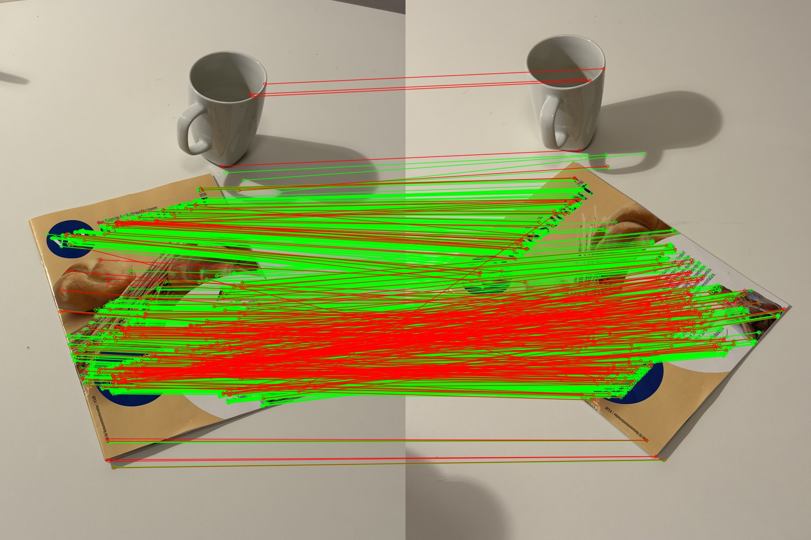
*Fig. 5.4: Matches between the two photos. Green: RANSAC inliers, red:
outliers. The red lines are drawn on top, so they look more dominant than
they are (17.5 % of the matches).*

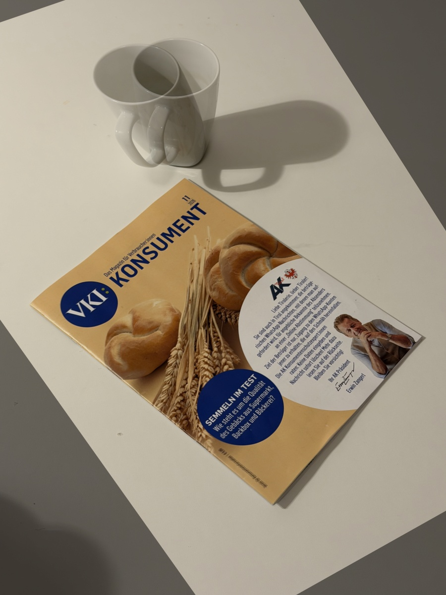
*Fig. 5.5: Photo 1 warped with the estimated H onto photo 2, blended 50 / 50.
The magazine is sharp, the cup appears twice.*

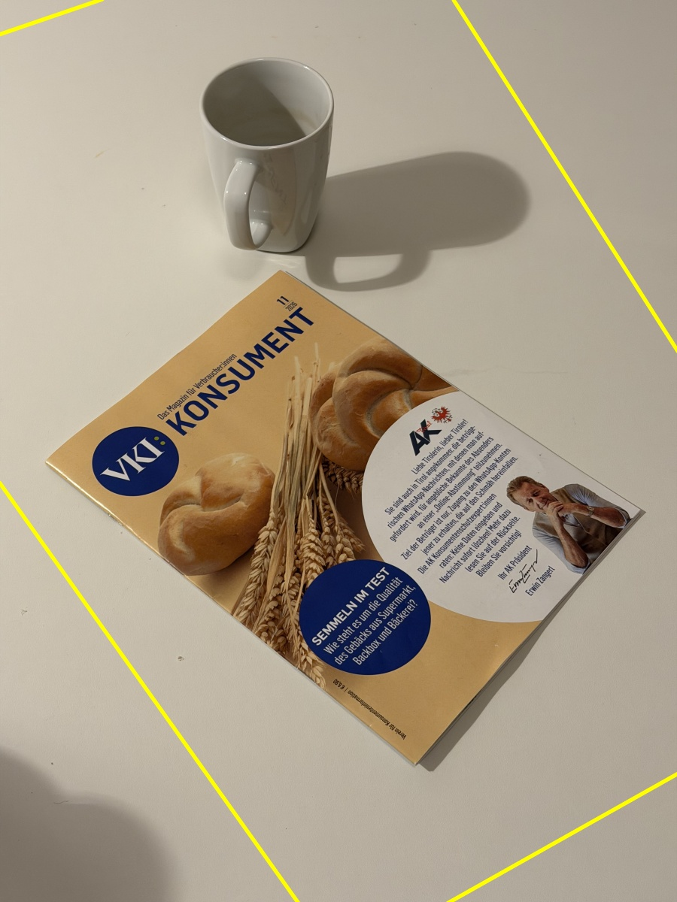
*Fig. 5.6: Photo 2 with the border of photo 1 mapped through H (yellow).*

### Observations

**Rotation.** All three detectors are rotation invariant. Between 30 and 90 deg
the number of correct matches stays almost constant and the precision stays
between 0.84 and 0.97 (Fig. 5.2). ORB computes an orientation for every FAST
corner from the intensity centroid and rotates its BRIEF pattern accordingly.
AKAZE and BRISK also estimate a main orientation for each keypoint. The drop
from 0 to 30 deg is caused by the warp, not by the detectors: interpolation
blurs the image and the corners of the image leave the frame. 90 deg is better
than 30 and 60 deg for all three, because a 90 deg rotation maps pixels
exactly onto the pixel grid and nothing is interpolated.

**Scale.** All three detect keypoints at several scales (ORB: image pyramid
with 8 levels and factor 1.2, AKAZE: nonlinear scale space, BRISK: scale space
over octaves), so in the range 0.5 to 2 all of them keep a precision of at
least 0.76. At the extremes they differ (Fig. 5.3). At 0.25 BRISK keeps 0.89
precision and the most correct matches (143), while ORB and AKAZE drop to
about 0.7. At 3 all three fall to about 0.6, ORB is the lowest with 0.54. ORB
is therefore only scale invariant in a limited range: its pyramid covers
1.2^7 = 3.6x, and at the strongest changes the matching keypoints are no longer
in the same pyramid levels. AKAZE is the most stable when the image gets
bigger (scale 2: 0.86), BRISK when it gets smaller. The number of correct
matches at scale 2 and 3 is also low because most of the enlarged image is
outside the frame.

**Is the ranking the same for every transformation?** No. By the number of
correct matches ORB is first in almost every case, but this is mostly because
it is allowed 2000 keypoints and AKAZE and BRISK find only about 1100. The
exception is scale 0.25, where BRISK has twice as many correct matches. By
precision the winner changes: ORB for rotation 30 deg, scale 0.5 and tilt,
AKAZE for rotation 60 / 90 deg and scale 2 and 3, BRISK for scale 0.25. In
runtime the order is always the same: ORB is fastest, BRISK about 1.5x
slower, AKAZE about 5x slower (Table 5.2), because building the nonlinear
scale space is expensive. Overall AKAZE is the most robust, but ORB gives
almost the same precision for moderate transformations at a fraction of the
time.

**Real photos.** 82.5 % of the kept matches are RANSAC inliers. In the overlay
(Fig. 5.5) the magazine is sharp: text, logo and picture lie exactly on top
of each other. The cup appears twice, as expected: it sticks out of the plane,
and a homography only describes the mapping of one plane. Its matches are
therefore outliers (red in Fig. 5.4). Most other outliers lie in the block of
text on the right half of the magazine, where the same letters repeat and ORB
matches the wrong "e" or "n". The shadow of the cup is matched as inlier,
because it lies on the table plane and the lamp did not move. The mapped border
of photo 1 (Fig. 5.6) is a slightly distorted rectangle rotated by about 30
deg, which fits the camera movement.

**Why RANSAC here, but not in Exercise 1?** In Exercise 1 we clicked exactly
the 4 corners by hand. 4 correct point pairs give exactly the 8 equations for
the 8 unknowns of H, so `getPerspectiveTransform` can solve it directly and
there is nothing to reject. Here we have 1661 automatic matches, and a part of
them is wrong (the benchmark shows that even under ideal conditions precision
is below 1, and here 290 matches are outliers). A least-squares fit over all
matches would be pulled away by every wrong match. RANSAC fits H to random
sets of 4 matches, counts how many matches agree with it within 3 px and keeps
the H with the most inliers. Wrong matches do not agree with each other, so
they never win, and the cup is ignored as well, because it does not lie on
the dominant plane.
